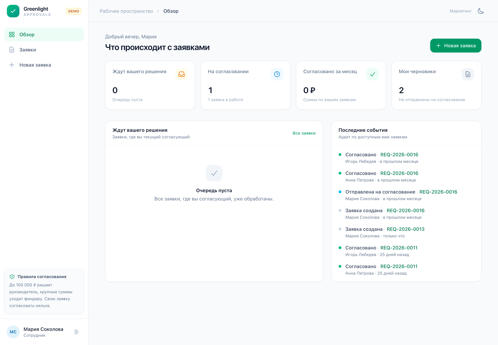
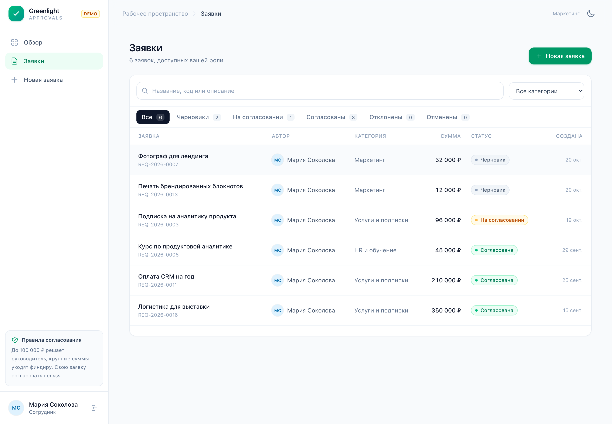
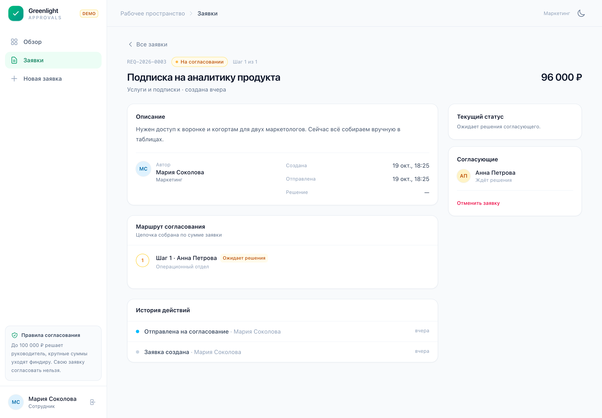
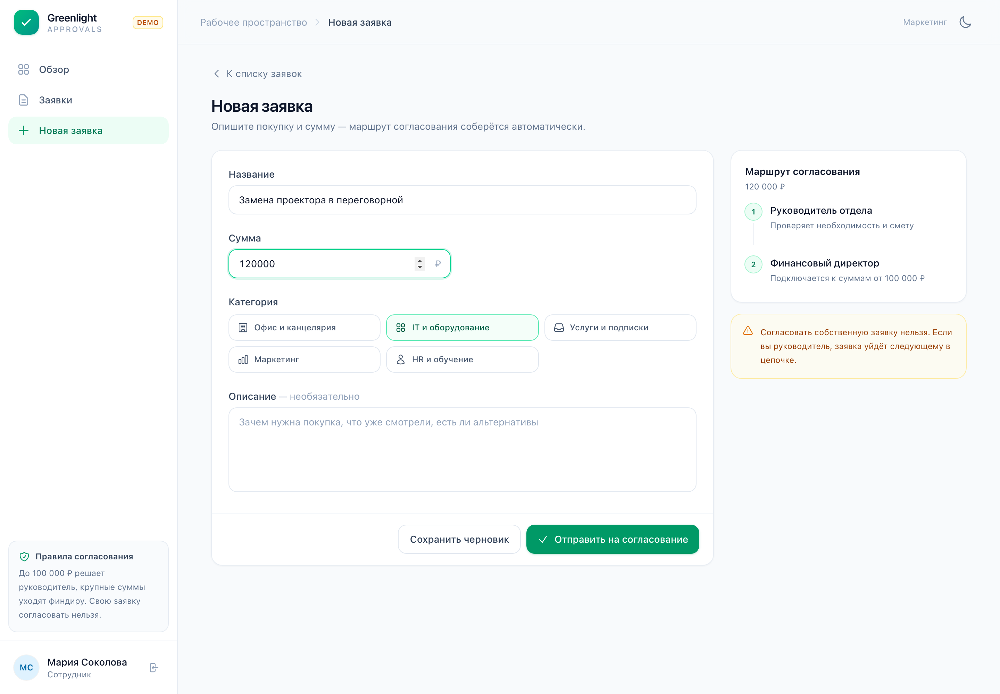
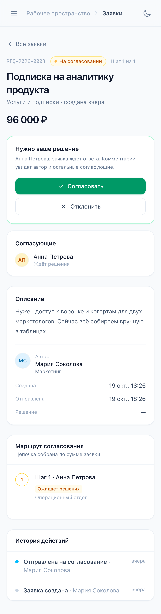
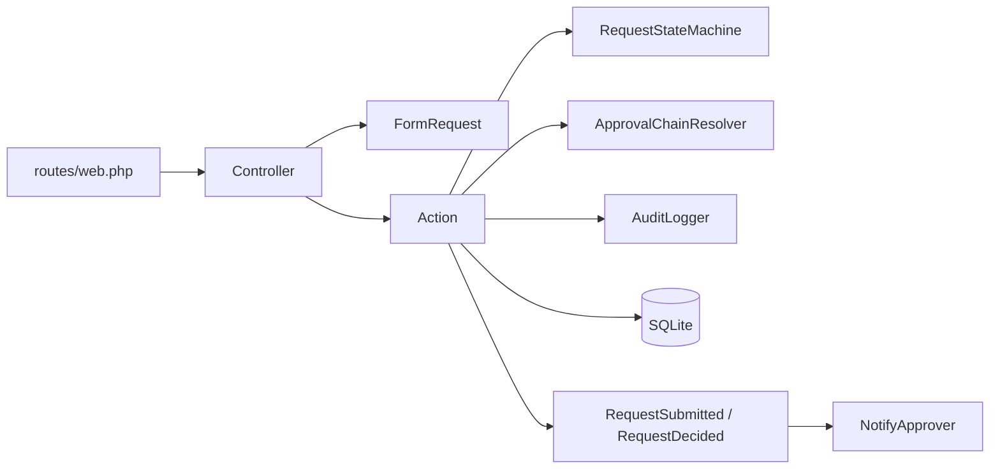
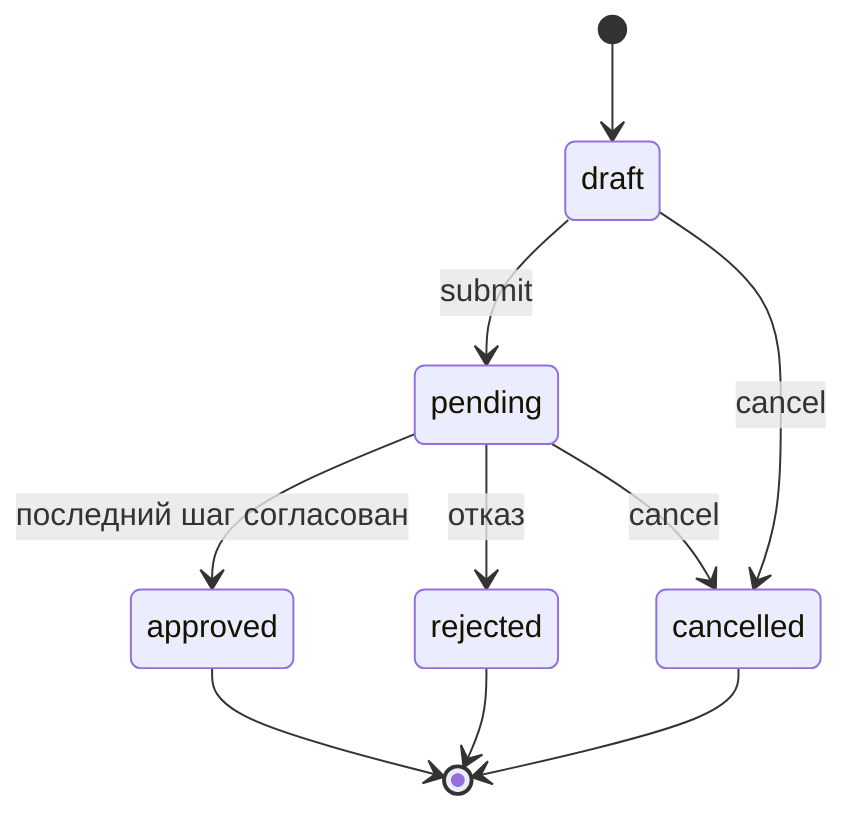

# Greenlight

Демо согласования заявок на закупку. Маршрут зависит от суммы, все решения падают в историю,
автор видит у кого сейчас лежит заявка.

Стек: Laravel 13, PHP 8.4, Inertia 3, Vue 3.5, Tailwind 4, SQLite, Docker.

## Запуск

Нужен только docker.

```bash
docker compose up --build
```

Первый запуск занимает пару минут: собирается образ, ставятся зависимости, создаётся и
заполняется база. Потом открыть [http://localhost:8000](http://localhost:8000).

Паролей нет, на входе просто выбираешь аккаунт.

| Кто | Роль | Отдел |
| --- | --- | --- |
| Мария Соколова | Сотрудник | Маркетинг |
| Дмитрий Орлов | Сотрудник | IT |
| Ольга Ким | Сотрудник | Операционный отдел |
| Анна Петрова | Руководитель отдела | Операционный отдел |
| Игорь Лебедев | Финансовый директор | Финансы |

Остановить: `docker compose down`. База лежит внутри контейнера, так что после `down` и
повторного `up` она пересоздастся с демо данными.

## Что потыкать

1. Зайти Марией, создать заявку на 45 000 ₽ и отправить. В маршруте будет один шаг.
2. Создать заявку на 240 000 ₽. Появится второй шаг с финдиром.
3. Зайти Анной и согласовать первую заявку. Свою согласовать не получится: кнопки не будет,
   а прямой POST вернёт ошибку.
4. Открыть уже согласованную заявку. Кнопки пропали, в истории видно кто и когда решил.
5. Нажать «Отклонить» и попробовать отправить без комментария. Форма не пропустит.
6. Переключить тёмную тему справа сверху.

## Скриншоты



<details>
<summary>Список заявок, карточка и мобильная версия</summary>









</details>

## Как устроено



Контроллер валидирует вход и дергает экшен. Экшен это readonly класс с `handle()`, вся запись
идёт через `DB::transaction()`. Доменные ошибки наследуются от одного базового исключения и
показываются тостом, а не 500.

Статусы:



*Схемы в README сгенерированы агентом.*

Правила:

- до 100 000 ₽ один шаг, руководитель отдела;
- от 100 000 ₽ руководитель, потом финансовый директор;
- автор заявки исключается из цепочки, иначе он упрётся в four eyes и заявка повиснет;
- согласовать свою заявку нельзя даже в обход интерфейса;
- у заявки есть `version`, он растёт на каждом изменении. Решение приходит вместе с версией,
  и если страница устарела, юзер получает ошибку, а не тихую перезапись чужого решения.

## Структура

```
app/
├── DTO/                     CreateRequestData, DecisionData
├── Enums/                   Role, RequestStatus, RequestCategory, ...
├── Events/                  RequestSubmitted, RequestDecided
├── Exceptions/Domain/       ожидаемые бизнес ошибки
├── Http/
│   ├── Actions/             Create / Submit / Decide / Cancel
│   ├── Controllers/         Auth, Dashboard, Request
│   ├── Middleware/          HandleInertiaRequests
│   ├── Requests/            валидация форм
│   └── Resources/           сериализация для Inertia
├── Listeners/               NotifyApprover
├── Models/                  PurchaseRequest, Approval, AuditEvent, User
├── Policies/                PurchaseRequestPolicy
└── Services/                RequestStateMachine, ApprovalChainResolver, AuditLogger

resources/js/
├── Components/              статусы, модалки, тосты, таблица
├── Composables/             useTheme
├── Layouts/                 AppLayout
├── pages/                   Auth/Login, Dashboard, Requests/{Index,Create,Show}
└── Utils/                   деньги и даты

tests/
├── Feature/                 полный цикл, права, http границы
└── Unit/                    переходы, сборка маршрута
```

## Тесты

```bash
docker compose run --rm tests
```

28 тестов: переходы статусов через data provider, сборка цепочки по сумме, автор не попадает
в маршрут, нельзя согласовать свою заявку, устаревшая версия, обязательный комментарий при
отказе, видимость заявок по ролям, отмена и удаление ожидающих шагов.

## Решения

- **SQLite.** Для демо не хотелось поднимать отдельный сервис. На постгре переносится без
  изменений, для нагрузки взял бы его.
- **Вход без пароля.** Это стенд, а не авторизация. В проде был бы SSO или пароль с 2FA.
- **Очередь синхронная.** Слушатель помечен `ShouldQueue`, но в демо `QUEUE_CONNECTION=sync`,
  чтобы не тащить redis и воркер. Меняется одной переменной.
- **Версия и `lockForUpdate`.** Блокировка убирает гонку в базе, версия не даёт принять решение
  по старой странице.
- **Нет репозиториев.** Eloquent и так слой доступа, обёртка была бы ради обёртки. Сложные
  выборки живут в скоупах модели.
- **Без UI кита.** Tailwind и несколько своих компонентов, меньше бандл и не надо бороться
  со стилями библиотеки.

## Что дальше

- уведомления (email или телеграм) и напоминания по зависшим заявкам;
- вложения и лимиты по бюджету отдела;
- REST API с Sanctum и идемпотентными ключами;
- экспорт реестра в XLSX и печатная форма;
- метрики: время согласования, где застревают заявки, доля отказов.

## Лицензия

MIT, см. [LICENSE](LICENSE). Данные вымышленные.
